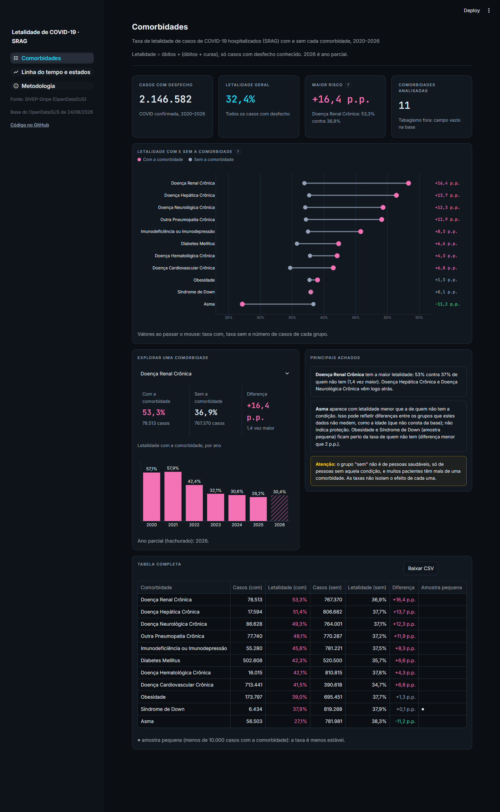
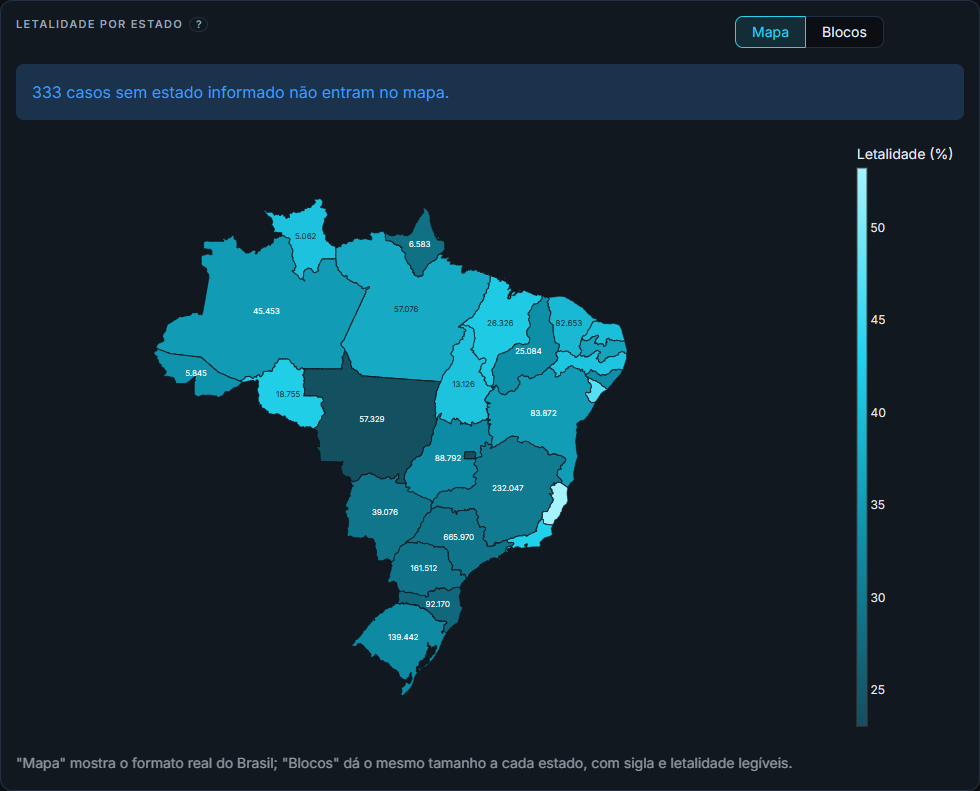
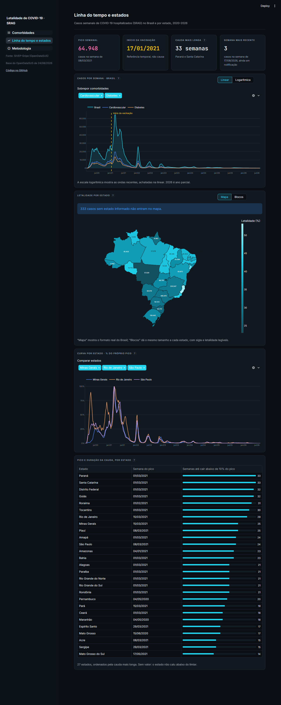

# Letalidade de COVID-19 por Comorbidade — Brasil


**[🔴 Ver o dashboard ao vivo](https://letalidade-covid-brasil.streamlit.app/)**

Pipeline de ETL (extração, tratamento e carga) e dashboard interativo que analisa a
**taxa de letalidade de COVID-19 por comorbidade, por estado e ao longo do tempo no
Brasil**, usando dados reais do SIVEP-Gripe (Ministério da Saúde).

## Print do dashboard


Taxa de letalidade por comorbidade — comparação entre quem tem e quem não tem cada condição.


Mapa coroplético do Brasil com a taxa de letalidade de COVID-19 por estado.


Comparação da curva de casos entre estados ao longo do tempo, normalizada pelo pico de cada um.

## O que este projeto faz

- Baixa os bancos de dados oficiais do SIVEP-Gripe (2020 a 2026) direto do OpenDataSUS.
- Filtra só os casos confirmados de COVID-19 dentro do banco de SRAG (Síndrome
  Respiratória Aguda Grave, que inclui outras causas além de COVID).
- Calcula a taxa de letalidade (óbitos ÷ (óbitos + curas), entre casos com desfecho
  conhecido) para 11 comorbidades, comparando quem tinha a condição com quem não tinha.
- Calcula a mesma taxa por estado e ao longo do tempo (semanal).
- Converte cada ano em Parquet (DuckDB) e gera as tabelas com consultas SQL sobre eles, com
  memória limitada a 400 MB.
- Valida os dados antes de gravar qualquer saída e publica um relatório de qualidade.
- Apresenta tudo num dashboard interativo (Streamlit): gráficos de barras, linha do
  tempo, mapa coroplético do Brasil por estado, e uma tabela explorável por comorbidade.

## Fonte dos dados

**SIVEP-Gripe** (Sistema de Informação da Vigilância Epidemiológica da Gripe), que
registra casos de Síndrome Respiratória Aguda Grave (SRAG) no Brasil. Dado bruto
disponibilizado pelo Ministério da Saúde através do
[OpenDataSUS](https://opendatasus.saude.gov.br/). Período coberto: 2020 a 2026 (2026 é
um ano parcial). Os contornos geográficos dos estados vêm da
[API oficial do IBGE](https://servicodados.ibge.gov.br/).

A metodologia completa (definição exata da taxa de letalidade e as limitações
identificadas) está documentada dentro do próprio dashboard, na seção
"Sobre este projeto / Metodologia".

## Como instalar e rodar

Estas instruções assumem que você nunca viu este projeto antes e está começando do zero.

> **Só quer ver o dashboard funcionando?** Os passos 5, 6 e 7 são **opcionais**.
> Os dados já processados (e o contorno geográfico dos estados) vêm prontos dentro
> do repositório, então você pode pular direto do passo 4 pro passo 8. Esses três
> passos só são necessários se você quiser gerar os dados novamente do zero — o que
> baixa ~4,9 GB de dados brutos do SIVEP-Gripe e pode demorar bastante.

### 1. Pré-requisitos

- Python 3.12 ou mais recente instalado ([python.org](https://www.python.org/downloads/)).
- Uns 6 GB de espaço livre em disco (os dados brutos baixados somam ~4,9 GB).

### 2. Baixar o projeto e entrar na pasta

```bash
git clone https://github.com/gustavocduarte/covid-letalidade-comorbidade.git
cd covid-letalidade-comorbidade
```

### 3. Criar e ativar um ambiente virtual

Um ambiente virtual isola as bibliotecas deste projeto do resto do seu sistema.

```bash
python -m venv .venv
```

Ativar (escolha o comando do seu sistema):

```bash
# Windows (PowerShell)
.venv\Scripts\Activate.ps1

# Windows (Git Bash) / Linux / macOS
source .venv/Scripts/activate   # Git Bash no Windows
source .venv/bin/activate       # Linux / macOS
```

### 4. Instalar as dependências

```bash
pip install -r requirements.txt
```

### 5. Rodar o pipeline de dados (extração + tratamento + carga) — opcional

*Pule para o passo 8 se você só quer ver o dashboard funcionando com os dados que já
vêm prontos no repositório.*

Isso baixa os 7 anos de dados brutos do SIVEP-Gripe (~4,9 GB no total — pode demorar
dependendo da sua internet) e gera os arquivos processados usados pelo dashboard. Os
CSVs brutos ficam salvos permanentemente em `data/raw/`, então esse download só
acontece uma vez. Cada ano também vira um Parquet em `data/processed/detalhado/`
(`ano=AAAA/casos.parquet`, só os casos de COVID e as colunas usadas; fora do git).

O pipeline usa DuckDB e requests, que o `requirements.txt` do dashboard não traz:

```bash
pip install -e .
python src/cli.py pipeline
```

Os comandos da linha de comando (`python src/cli.py --help`):

| Comando | O que faz |
|---|---|
| `pipeline` | baixa e converte só o que for preciso, valida e grava os CSVs de saída |
| `serie-estado` | regera só a série semanal por estado, a partir dos Parquets (sem baixar nem converter) |
| `geo` | baixa o contorno dos 27 estados na API do IBGE e confere cada sigla (passo 6) |
| `tudo` | `geo` (só se `data/geo/brasil_estados.geojson` não existir) e depois `pipeline` |

Opções do `pipeline` e do `tudo`:

- `--anos 2026` ou `--anos 2020 2022-2024`: baixa e converte só esses anos. As saídas
  (CSVs e relatório) sempre cobrem todos os anos; se faltar o Parquet de algum ano, o
  comando para sem gravar nada e diz qual comando rodar.
- `--forcar`: reconverte os anos escolhidos mesmo que já estejam em dia.
- `--rebaixar`: baixa de novo o CSV bruto dos anos escolhidos e o converte.

Código de saída: `0` ok, `1` validação reprovada, `2` uso incorreto (por exemplo, um ano
sem arquivo conhecido) e `3` faltam Parquets de anos que não foram processados.

**Execução incremental.** `data/processed/detalhado/estado.json` (fora do git) guarda, por ano,
de qual CSV (URL, tamanho e data de modificação) e de qual versão da conversão
(`VERSAO_CONVERSAO` em `config.py`) veio o Parquet. Um ano é pulado quando o Parquet existe e
tudo isso confere; o CSV só é baixado se não existir em `data/raw/`. O estado é só uma dica: o
disco manda (Parquet apagado ou estado ilegível significam reconverter). Com os dados reais, a
segunda execução seguida leva uns 9 s (contra uns 40 s da primeira), porque só calcula,
valida e grava as saídas. Os CSVs e o Parquet são gravados num arquivo parcial e renomeados
no fim, então uma interrupção não deixa arquivo pela metade.

*Ideia futura:* o arquivo do ano corrente é um banco "vivo", atualizado toda semana na fonte,
e hoje só é rebaixado com `--rebaixar`. Dá para detectar a atualização com uma requisição
HEAD à URL, comparando `ETag` ou `Content-Length` com o que foi baixado.

### 6. Baixar o contorno geográfico dos estados (pro mapa) — opcional

```bash
python src/cli.py geo
```

### 7. Regerar só a série semanal de casos por estado — opcional

O `pipeline` já gera essa série. Este comando a regera a partir dos Parquets, sem baixar
nem converter nada:

```bash
python src/cli.py serie-estado
```

### 8. Rodar o dashboard

```bash
streamlit run src/dashboard.py
```

Abra **http://localhost:8501** no navegador.

### Rodar os testes automatizados (opcional)

`requirements.txt` traz só o que o dashboard precisa. Para rodar o pipeline e os testes,
instale também as dependências do pipeline e as de desenvolvimento (pytest e ruff), que
estão declaradas no `pyproject.toml`:

```bash
pip install -r requirements.txt -e ".[dev]"
pytest
ruff check .
```

O teste de regressão "dourado" (`pytest -m golden`) roda o pipeline completo sobre os
dados brutos de `data/raw/` (~4,8 GB, uns 3 minutos) e compara com os CSVs versionados.
Ele fica fora da execução padrão e só roda sob demanda, localmente. Além dos CSVs, confere
que os Parquets batem com o resumo versionado em `tests/golden/detalhado_resumo.json`
(linhas, óbitos, curas, casos por UF e contagem de valores de cada coluna, por ano).

## Como o pipeline funciona

```
data/raw/INFLUDaa.csv ──► Parquet por ano ──► consultas SQL (DuckDB) ──► CSVs em data/processed/ ──► dashboard
   (194 colunas)          data/processed/       src/consultas.py          (pequenos, versionados)
                          detalhado/ano=AAAA/
                          (casos de COVID,
                           14 colunas)
```

1. `conversao.py` lê o CSV bruto com DuckDB, fica só com `CLASSI_FIN = 5` e as colunas
   usadas, com tipos (datas como DATE, códigos como inteiros), e grava um Parquet zstd.
2. `consultas.py` calcula letalidade por comorbidade e por estado e as séries semanais
   direto nos Parquets (uma view `casos` sobre `ano=*/`).
3. `validacao.py` confere os dados e as tabelas calculadas (veja "Validação dos dados" abaixo).
4. `pipeline.py` orquestra os passos (só refaz os anos que mudaram) e, se a validação passar,
   grava os CSVs com `load.py`. `cli.py` é a linha de comando que o chama.

**Memória e tamanho.** A conversão e as consultas rodam com o DuckDB limitado a 400 MB
(o excedente iria para disco temporário). Medido com o pandas como referência:

| | pandas | DuckDB (limite de 400 MB) |
|---|---|---|
| Ano 2021 (1,8 GB de CSV, 1,2 milhão de casos): pico de memória / tempo | 0,74 GiB / 24 s | 0,21 GiB / 12 s |
| Pipeline completo (7 anos, com a validação no caso do DuckDB): pico de memória / tempo | 0,74 GiB / 71 s | 0,20 GiB / 41 s |
| Casos de COVID de 2021 em disco | 71,1 MiB (CSV) | 4,3 a 5,0 MiB (Parquet zstd) |

Os Parquets dos 7 anos somam 8,4 MiB, contra 141 MB do cache em CSV que o pipeline gerava
antes.

## Validação dos dados

Depois de converter os anos e calcular as tabelas, e **antes de gravar qualquer CSV**, o
pipeline roda verificações em SQL sobre os Parquets (`validacao.py`). Cada achado é um **erro**
ou um **aviso**:

| Nível | O que dispara |
|---|---|
| **Erro** | `EVOLUCAO` fora de {1, 2, 3, 9} ou comorbidade fora de {1, 2, 9} (vazio vale); mais de 1% dos casos de um ano sem data de início dos sintomas ou com data fora do ano (± 7 dias, já que os arquivos anuais são cortados por semana epidemiológica); e qualquer violação das conferências entre as tabelas e os Parquets: 11 comorbidades por ano, óbitos ≤ desfechos conhecidos ≤ casos, taxas entre 0 e 1, agregado igual à soma dos anos, e soma dos casos por estado e das séries semanais igual ao total de casos |
| **Aviso** | casos sem UF ou com UF fora das 27 siglas (ficam fora das tabelas por estado, mas são contados); até 1% de datas inválidas; mais de 20% de casos sem desfecho conhecido em um ano (num ano parcial e recente, muitos casos ainda estão em andamento, então esse aviso pode ser esperado); ano sem nenhum caso de COVID |

- **Com erro**, o pipeline grava o relatório, não grava nenhum CSV de saída (os CSVs anteriores,
  que o dashboard usa, ficam como estavam) e termina com código de saída 1.
- **`data/processed/relatorio_qualidade.json`** é gravado em todos os casos e versionado. Traz,
  por ano e no total, as contagens de cada problema, a lista de achados e `"aprovado"`
  (verdadeiro quando não há erro). Não tem data nem hora, então a mesma entrada gera sempre o
  mesmo arquivo, e o teste golden o compara com o versionado.
- Com os dados reais, o relatório sai aprovado, com 333 casos sem UF (de 2.291.279) e nenhum
  outro problema. O dashboard lê o relatório e, só quando ele está aprovado e há casos sem UF,
  mostra "N casos sem estado informado não entram no mapa".

## Estrutura de pastas

```
covid-letalidade-comorbidade/
├── data/
│   ├── raw/          # CSVs brutos do SIVEP-Gripe, um por ano (gerado pelo passo 5)
│   ├── processed/    # Dados já tratados, usados pelo dashboard (gerado pelos passos 5-7)
│   │   ├── detalhado/  # Parquets por ano (ano=AAAA/casos.parquet) e estado.json, fora do git
│   │   └── relatorio_qualidade.json  # Relatório da validação (versionado)
│   └── geo/          # Contorno geográfico dos estados em GeoJSON (gerado pelo passo 6)
├── docs/             # Dicionário de dados oficial do SIVEP-Gripe (PDF) e texto extraído
├── src/
│   ├── extract.py              # E do ETL: baixa os CSVs brutos do OpenDataSUS
│   ├── conversao.py            # T do ETL: CSV bruto -> Parquet só com casos de COVID (DuckDB)
│   ├── consultas.py            # T do ETL: taxas de letalidade e séries semanais em SQL (DuckDB)
│   ├── transform.py            # Versão pandas das mesmas contas, mantida como referência dos testes
│   ├── load.py                 # L do ETL: salva os resultados em data/processed/
│   ├── config.py               # Caminhos, URLs, colunas e códigos de domínio
│   ├── validacao.py            # Verificações de qualidade (SQL sobre os Parquets) e relatório
│   ├── qualidade.py            # Lê o relatório para o aviso do dashboard
│   ├── estado.py               # Estado incremental: o que já foi convertido em cada ano
│   ├── pipeline.py             # Orquestra E-T-L pros 7 anos, pulando os que estão em dia
│   ├── cli.py                  # Linha de comando: geo, pipeline, serie-estado, tudo
│   ├── geo.py                  # Baixa e verifica o contorno dos 27 estados (API do IBGE)
│   └── dashboard.py            # O dashboard Streamlit em si
├── tests/
│   ├── test_transform.py       # Testes da lógica de transformação (versão pandas)
│   ├── test_conversao.py       # CSV bruto -> Parquet sobre a amostra sintética
│   ├── test_consultas.py       # Consultas SQL contra o pandas e contra valores calculados à mão
│   ├── test_travas.py          # As travas de teste: sem rede e sem escrita em data/
│   ├── test_validacao.py       # Verificações, invariantes e relatório de qualidade
│   ├── test_qualidade.py       # Aviso de casos sem estado (lógica e dashboard renderizado)
│   ├── test_estado.py          # Estado do pipeline incremental
│   ├── test_extract.py         # Download atômico do CSV bruto
│   ├── test_cli.py             # Subcomandos, --anos e códigos de saída
│   ├── test_pipeline_e2e.py    # Pipeline (pela CLI) de ponta a ponta, inclusive o incremental, sobre uma amostra sintética
│   ├── test_golden.py          # Regressão: pipeline completo vs. CSVs versionados (só local)
│   ├── golden/                 # Resumo versionado dos Parquets (referência do teste golden)
│   └── fixtures/               # Amostra sintética do SIVEP-Gripe usada nos testes
├── pyproject.toml              # Dependências por grupo, Python mínimo e config do pytest/Ruff
├── requirements.txt            # Dependências do dashboard, com versões fixas (Streamlit Cloud)
├── CLAUDE.md                   # Regras de trabalho do projeto
└── README.md
```

## Notas técnicas

- O mapa por estado usa `plotly.express.choropleth_map` (renderização via WebGL/MapLibre)
  em vez de `choropleth` (SVG) ou do Altair — foi a solução encontrada pra um problema de
  renderização de mapas SVG complexos identificado durante o desenvolvimento neste
  ambiente específico.
- O campo de tabagismo (`TABAG`) existe no formulário oficial do SIVEP-Gripe, mas não é
  preenchido na prática pelos postos de saúde — por isso não entra na análise.
- Ferramentas de desenvolvimento (Ruff para lint, pytest para testes) ficam no extra `dev`
  do `pyproject.toml`, fora do `requirements.txt`, que o Streamlit Cloud lê para instalar
  só o dashboard: `pip install -r requirements.txt -e ".[dev]"`.
